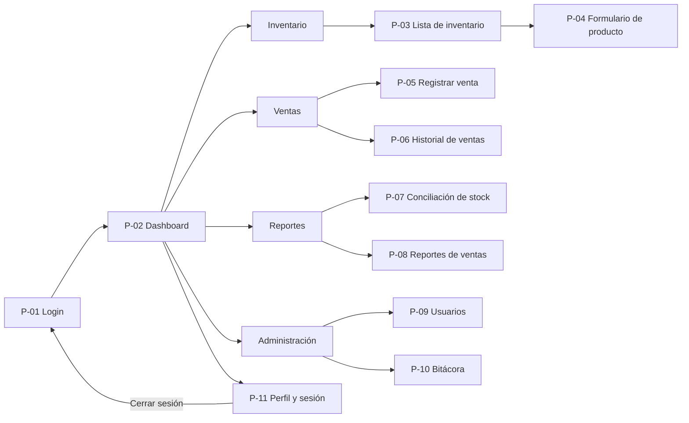
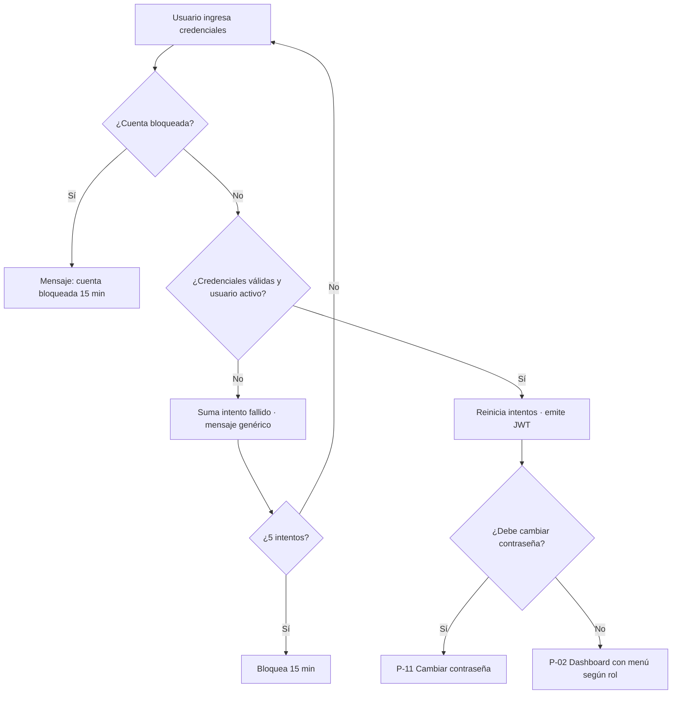
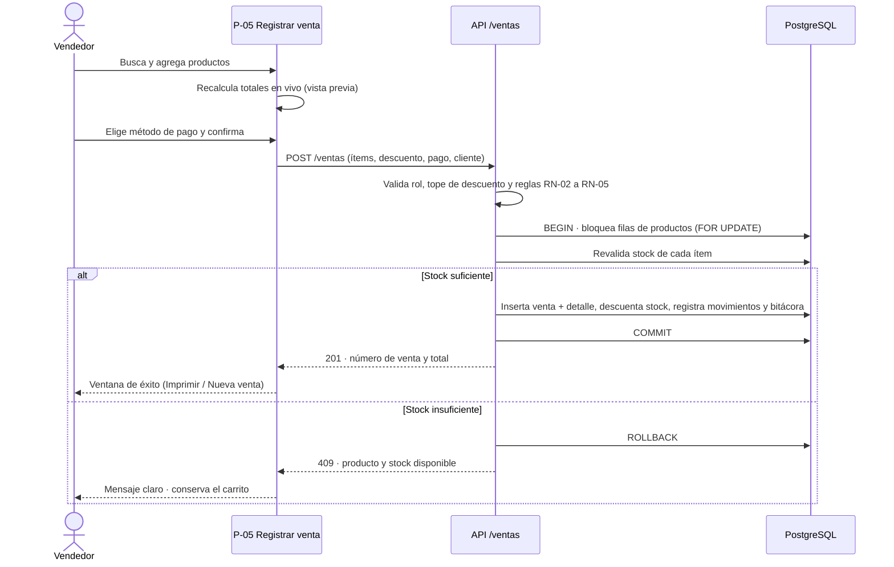
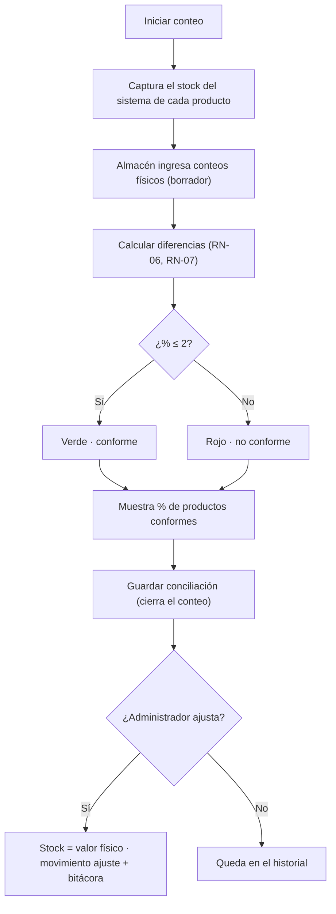

# 02 · Flujos del sistema y pantallas

> **Fuente oficial** de **cómo se comporta** el sistema: quién puede hacer qué, por dónde navega,
> qué pasa al presionar cada botón y cómo fluyen los procesos de negocio.
> Los IDs de requerimientos (RF/RNF/RN) están en [01-requerimientos.md](./01-requerimientos.md).

---

## 1. Roles y permisos

El permiso se valida **en el servidor** (RNF-24). Ocultar botones en la interfaz es solo comodidad, no seguridad.

| Funcionalidad | Administrador | Vendedor | Almacenero | Gerente |
| --- | :---: | :---: | :---: | :---: |
| Dashboard | ✓ | ✓ (sus ventas) | ✓ (stock) | ✓ |
| Ver inventario | ✓ | ✓ | ✓ | ✓ |
| Crear/editar productos, ingresos y ajustes de stock | ✓ | — | ✓ | — |
| Registrar venta | ✓ | ✓ | — | — |
| Historial de ventas | ✓ (todas) | ✓ (propias) | — | ✓ (lectura) |
| Anular venta | ✓ | — | — | — |
| Ingresar conteo físico | ✓ | — | ✓ | — |
| Ajustar stock según conteo | ✓ | — | — | — |
| Reportes de ventas | ✓ | — | — | ✓ |
| Usuarios y bitácora | ✓ | — | — | — |

---

## 2. Mapa de navegación

El menú lateral **solo muestra** los módulos permitidos para el rol de la sesión.

---

## 3. Flujos de negocio principales

### F-01 · Inicio de sesión

### F-02 · Registrar una venta (flujo crítico)

**Reglas clave:** el total que vale es el que **calcula el servidor** (el de la interfaz es solo vista previa). Todo ocurre en una transacción: o se guarda todo, o nada (RF-23, RNF-16).

### F-03 · Ingreso y ajuste de stock

1. El almacenero abre P-03 y elige **Registrar ingreso** o **Ajustar stock** en un producto.
2. **Ingreso:** cantidad entera > 0, proveedor, documento y fecha → suma al stock y registra movimiento `ingreso`.
3. **Ajuste:** nuevo stock ≥ 0 y motivo obligatorio → reemplaza el stock y registra movimiento `ajuste` + bitácora.
4. Si el stock resultante ≤ stock mínimo, el producto pasa a estado `bajo` y aparece en las alertas (RF-13).

### F-04 · Conciliación de stock (conteo físico)

La captura evita que las ventas hechas **durante** el conteo alteren la comparación.

### F-05 · Anulación de venta

Administrador → P-06 → **Anular** → motivo obligatorio → confirmar → en una transacción: venta pasa a `anulada`, el stock se devuelve, se registran los movimientos `anulación` y la bitácora.

---

## 4. Reglas de UX comunes (aplican a todas las pantallas)

- Toda acción exitosa muestra un **aviso breve (toast)**. Todo error dice **qué pasó y cómo corregirlo**.
- Las acciones destructivas (anular, desactivar, ajustar stock) piden **confirmación con un diálogo**.
- Los formularios **validan mientras se escribe** y **no borran** lo digitado cuando hay un error.
- Las listas muestran **skeleton** al cargar y un **estado vacío con acción sugerida** (ej.: "Aún no hay productos. Registra el primero").
- El botón principal de cada pantalla es el más destacado; los botones se **deshabilitan** si falta información obligatoria.
- Montos con 2 decimales y prefijo `S/`; números alineados a la derecha con cifras tabulares.
- Todo el texto de la interfaz en **español**, con el mismo nombre de acción en todo el flujo (el botón "Guardar producto" produce el aviso "Producto guardado").

---

## 5. Detalle de pantallas

### P-01 · Inicio de sesión
**Flujo:** el usuario abre el sistema, ingresa sus credenciales y entra al Dashboard.

| Elemento | Acción | Resultado |
| --- | --- | --- |
| Campos Usuario y Contraseña | Escribir; Enter envía | Validación en línea de campos vacíos. |
| Ícono de ojo | Clic | Muestra u oculta la contraseña. |
| **Iniciar sesión** | Clic | Éxito: Dashboard con menú según rol. Error: "Usuario o contraseña incorrectos" (sin decir cuál falló). Tras 5 intentos, bloqueo de 15 min. |
| ¿Olvidó su contraseña? | Clic | Aviso para contactar al administrador (la restablece en P-09). |

### P-02 · Dashboard
**Flujo:** pantalla de inicio con indicadores; atajo a las tareas frecuentes.

| Elemento | Acción | Resultado |
| --- | --- | --- |
| Tarjetas de indicadores (ventas de hoy, del mes, productos activos, stock bajo) | Clic | Lleva al módulo relacionado; "Stock bajo" abre Inventario filtrado. |
| **+ Nueva venta** | Clic | Abre P-05. |
| Gráfico de ventas de 7 días | Cursor encima | Muestra el monto de cada día. |
| Tabla de últimas ventas | Clic en fila | Abre el detalle de la venta (P-06). |
| Menú lateral | Clic | Navega; solo opciones permitidas para el rol. |

### P-03 · Inventario (lista)
**Flujo:** el almacenero busca un producto, lo edita o registra un ingreso; el vendedor solo consulta.

| Elemento | Acción | Resultado |
| --- | --- | --- |
| Buscador | Escribir (debounce 300 ms) | Filtra por nombre o código. |
| Filtros (categoría, estado de stock) | Seleccionar | Actualiza la tabla. |
| **+ Nuevo producto** | Clic | Abre P-04 en modo crear. |
| Editar (lápiz) | Clic | Abre P-04 con datos cargados. |
| Registrar ingreso | Ventana: cantidad, proveedor, documento, fecha | Suma stock y registra movimiento. Error si cantidad ≤ 0. |
| Ajustar stock | Ventana: nuevo stock y motivo obligatorio | Actualiza stock; registro en kardex y bitácora. |
| Ver kardex | Clic | Movimientos del producto (fecha, tipo, cantidad, usuario). |
| Desactivar | Clic y confirmar | Producto inactivo; deja de aparecer en ventas. |
| Exportar | Clic | Excel o CSV de la lista filtrada. |
| Paginación | Clic | 20 filas por página. |

### P-04 · Formulario de producto
**Campos:** SKU, nombre, categoría, unidad (metro, cono, unidad, bolsa), precio de venta, stock inicial (solo al crear), stock mínimo.

| Elemento | Acción | Resultado |
| --- | --- | --- |
| **Guardar producto** | Clic | Valida RN-09 + SKU único. Éxito: vuelve a P-03 con aviso "Producto guardado". Error: campos en rojo con mensaje debajo, sin perder lo escrito. |
| Cancelar | Clic | Si hay cambios pide confirmación; vuelve a P-03. |

### P-05 · Registrar venta
**Flujo:** pantalla central, pensada para rapidez (RNF-08: ≤ 5 clics, < 1 min). Izquierda: buscador de productos. Derecha: carrito y resumen.

| Elemento | Acción | Resultado |
| --- | --- | --- |
| Buscador de producto | Escribir nombre o código | Resultados con precio y stock disponible. |
| **Agregar** (o Enter) | Clic | Agrega 1 unidad; si ya estaba, suma 1. |
| Cantidad (+ / − / campo) | Editar | Recalcula. Si supera el stock: "Solo hay X disponibles" y limita. |
| Quitar ítem (papelera) | Clic | Elimina y recalcula. |
| Descuento % | Escribir | 0 a 100; vendedor con tope (\*10 %). Recalcula. |
| Cliente (opcional) | Nombre o DNI | Se asocia a la venta. |
| Método de pago | Efectivo, Yape/Plin, transferencia, tarjeta | Obligatorio para confirmar. |
| Resumen | Automático | Subtotal, descuento, IGV (18 %) y total. |
| **Confirmar venta** | Clic (deshabilitado con carrito vacío) | Flujo F-02. Éxito: ventana con número y total + "Imprimir comprobante" / "Nueva venta". Error de stock: indica el producto y conserva el carrito. |
| Imprimir comprobante | Clic | PDF del comprobante interno. |
| Cancelar venta | Clic y confirmar | Vacía el carrito. |

Atajos de teclado sugeridos: `/` enfoca el buscador, `Enter` agrega el primer resultado, `Ctrl+Enter` confirma la venta.

### P-06 · Historial de ventas

| Elemento | Acción | Resultado |
| --- | --- | --- |
| Filtros (fecha, vendedor, método de pago) | Seleccionar | Actualiza la tabla. |
| Ver detalle | Clic | Ventana con ítems, descuento, IGV y total. |
| Reimprimir | Clic | Genera de nuevo el PDF. |
| Anular venta (solo admin) | Motivo + confirmar | Flujo F-05. Sin motivo no se puede confirmar. |
| Exportar | Clic | Excel o CSV. |

### P-07 · Conciliación de stock
**Flujo:** F-04. Mide el criterio ≤ 2 % del informe.

| Elemento | Acción | Resultado |
| --- | --- | --- |
| **Iniciar conteo** | Clic | Crea la sesión y captura el stock del sistema. |
| Conteo físico (campo por producto) | Entero ≥ 0 | Se guarda como borrador; rechaza negativos o decimales. |
| **Calcular diferencias** | Clic | % por producto (RN-06/RN-07), semáforo y % de productos conformes. |
| Guardar conciliación | Clic | Cierra la sesión y la deja en el historial. |
| Ajustar stock al conteo (solo admin) | Seleccionar, motivo, confirmar | Stock = físico; movimiento de ajuste y bitácora. |
| Exportar | Clic | PDF o Excel. |

### P-08 · Reportes de ventas

| Elemento | Acción | Resultado |
| --- | --- | --- |
| Rango (hoy, 7 días, mes, personalizado) | Seleccionar | Actualiza gráfico y tabla. |
| Agrupar por día, producto o vendedor | Seleccionar | Cambia la agrupación. |
| Pestañas "Más vendidos" y "Stock bajo" | Clic | Muestra el reporte elegido. |
| Exportar | Clic | PDF o Excel. |

### P-09 · Usuarios (administrador)

| Elemento | Acción | Resultado |
| --- | --- | --- |
| **+ Nuevo usuario** | Ventana: nombre, usuario, rol, contraseña temporal | Valida usuario único y contraseña ≥ 8 caracteres. |
| Editar | Clic | Cambia nombre y rol. |
| Activar / Desactivar | Clic y confirmar | Inactivo no puede entrar y su sesión se invalida. |
| Restablecer contraseña | Clic y confirmar | Contraseña temporal; debe cambiarla al entrar. |

### P-10 · Bitácora (administrador)
Solo lectura. Filtros por usuario, acción y fecha; exportable. Cada fila: quién, qué acción, sobre qué registro y cuándo.

### P-11 · Perfil y sesión

| Elemento | Acción | Resultado |
| --- | --- | --- |
| Cambiar contraseña (actual, nueva, confirmar) | Guardar | Valida la actual, el mínimo y que coincidan. |
| Cerrar sesión | Clic | Invalida el token y vuelve a P-01. |
| Aviso de inactividad | 1 min antes de los 15 min | "Continuar" extiende; si no responde, se cierra sola. |
