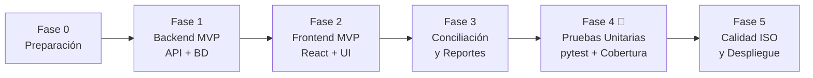

# 03 · Plan de desarrollo por fases

> **Fuente oficial del orden de trabajo.** El sistema se construye de forma ágil y por módulos funcionales.
> **Las pruebas unitarias formales y la matriz de casos se concentran en la Fase 4**, una vez que el sistema está operativo.
> Al terminar una fase o tarea, se marca `[x]` en este archivo y se anota la fecha en el [registro de avance](#registro-de-avance).

**Leyenda:** `[ ]` pendiente · `[~]` en progreso · `[x]` terminada · 🎯 = entregable principal para el curso de Calidad

---

## Vista general

| Fase | Objetivo | Requerimientos | Skills aplicadas |
| :---: | --- | --- | --- |
| 0 | Esqueleto del repositorio y configuración | RNF-17, RNF-20 | `fastapi-best-practices` |
| 1 | Backend funcional: API REST, BD, Auth, Inventario y Ventas transaccionales | RF-01 al RF-04, RF-07, 08, 10 al 13, RF-17 al 23, 25 | `fastapi-best-practices` |
| 2 | Frontend funcional: Interfaz propia (Login, Inventario, Caja/Ventas con carrito) | P-01, P-02, P-03, P-04, P-05, P-06 | `frontend-design`, `web-design-guidelines` |
| 3 | Módulos de Conciliación de stock (semáforo) y Reportes de ventas (backend + UI) | RF-27 al RF-30 · P-07, P-08 | `fastapi-best-practices`, `web-design-guidelines` |
| **4** 🎯 | **Suite de Pruebas Unitarias exhaustiva con pytest + matriz de casos + cobertura** | RF-07, RF-19, RF-21, RF-23, RF-28 · RNF-02, RNF-03, RNF-18 | `pruebas-unitarias-pytest` |
| 5 | Evidencias de calidad ISO 25010, Docker y entrega final | RNF-01 a 28 · despliegue | `desarrollo-textileria` |

---

## Fase 0 · Preparación del proyecto

**Objetivo:** dejar la estructura del repositorio lista para programar.

- [x] 0.1 Inicializar Git con `.gitignore` (Python, Node, `.env`, `htmlcov/`, `.coverage`, `*.db`).
- [x] 0.2 Crear `backend/` con `uv init` · `pyproject.toml` con `requires-python = ">=3.12"`.
- [x] 0.3 Configurar herramientas en `pyproject.toml` (`ruff`, `pytest`, `pytest-cov`).
- [x] 0.4 Crear estructura modular de carpetas (`app/auth`, `app/inventario`, `app/ventas`, `app/conciliacion`, `app/core`).
- [x] 0.5 Crear `README.md` con instrucciones de arranque rápido.

---

## Fase 1 · Backend MVP (API REST + Base de datos)

**Objetivo:** tener el servidor corriendo con FastAPI, base de datos SQLite y endpoints para autenticación, gestión de productos y procesamiento transaccional de ventas.

### 1.A Infraestructura y Base de Datos
- [x] 1.1 Dependencias: `fastapi`, `uvicorn`, `sqlalchemy>=2`, `pydantic-settings`, `pyjwt`, `bcrypt`.
- [x] 1.2 Configuración (`app/core/config.py`) y conexión a base de datos (`app/core/database.py`) usando la variable `DATABASE_URL` en `.env`. Permite SQLite local para desarrollo inmediato y migración directa a Supabase (PostgreSQL en la nube) o MySQL sin tocar el código.
- [x] 1.3 Modelos ORM (`Usuario`, `Categoria`, `Producto`, `MovimientoInventario`, `Venta`, `DetalleVenta`).
- [x] 1.4 Script de datos semilla con usuarios (admin, vendedor, almacenero) y productos textiles reales.

### 1.B Autenticación y Usuarios (RF-01 al RF-04)
- [x] 1.5 Endpoint `POST /auth/login` con JWT y hashing BCrypt de contraseñas.
- [x] 1.6 Dependencia de autorización por roles (`requiere_rol`).

### 1.C Inventario y Productos (RF-07, 08, 10, 11, 12, 13)
- [x] 1.7 Endpoints CRUD de productos (`GET /productos`, `POST /productos`, `PUT /productos/{id}`).
- [x] 1.8 Endpoints para ingresos y ajustes de stock con registro de movimientos.

### 1.D Ventas Transaccionales (RF-17 al RF-23, RF-25)
- [x] 1.9 Función de cálculo de totales (`calcular_total_venta`) con subtotal, descuento, IGV 18% y total a 2 decimales (`Decimal`).
- [x] 1.10 Endpoint `POST /ventas`: transacción ACID única que revalida stock, descuenta inventario y crea el comprobante interno de venta.
- [x] 1.11 Endpoint `GET /ventas`: listado de historial de ventas con filtros.

**Criterio de salida:** Swagger (`http://localhost:8000/docs`) permite hacer login, crear productos y registrar ventas con descuento y stock actualizado.

---

## Fase 2 · Frontend MVP (Interfaz de Usuario)

**Objetivo:** construir la interfaz web con React + Vite + Tailwind + shadcn/ui aplicando identidad visual textil (no genérica de IA).

- [x] 2.1 Inicializar frontend con Vite + React + TypeScript + Tailwind CSS.
- [x] 2.2 Configurar paleta de colores y componentes base según `docs/04-brief-diseno.md`.
- [x] 2.3 Pantalla P-01: Inicio de sesión conectado a la API.
- [x] 2.4 Pantalla P-02: Dashboard principal con accesos y navegación según el rol.
- [x] 2.5 Pantalla P-03 y P-04: Catálogo de productos, buscador rápido, filtros y formulario de creación.
- [x] 2.6 Pantalla P-05: Módulo de ventas / Punto de venta con carrito, atajos de teclado, cálculo en vivo y confirmación.
- [x] 2.7 Pantalla P-06: Historial de ventas realizadas.

**Criterio de salida:** El vendedor puede iniciar sesión en la web, buscar un producto, agregarlo al carrito y concretar una venta real reflejada en el inventario.

---

## Fase 3 · Conciliación de Stock y Reportes

**Objetivo:** implementar el flujo que mide el indicador de stock de la empresa (semáforo del 2%) y reportes.

- [x] 3.1 Backend de conciliación (`POST /conteos`, `POST /conteos/{id}/calcular` con el cálculo de diferencia porcentual, ajuste de inventario transaccional).
- [x] 3.2 Pantalla P-07: Interfaz de conteo físico de stock con indicador visual tipo semáforo accesible (verde ≤ 2 %, rojo > 2 %, badges e íconos RNF-11).
- [x] 3.3 Backend y Pantalla P-08: Reportes de ventas con gráficos analíticos (Recharts), productos más vendidos, rendimiento de vendedores y alertas críticas.

---

## Fase 4 · Suite de Pruebas Unitarias y Aseguramiento de Calidad 🎯 (ENTREGA UCV)

**Objetivo:** desarrollar y ejecutar la suite completa de pruebas unitarias con `pytest` para las 4 funciones críticas, generar el reporte de cobertura HTML y la matriz de casos de prueba para el informe académico.

### 4.A Las 4 Funciones Críticas Evaluadas
- [x] 4.1 Pruebas unitarias de `validar_producto` y `estado_stock` (`tests/unit/test_validar_producto.py`).
- [x] 4.2 Pruebas unitarias de `calcular_total_venta` (`tests/unit/test_calcular_total_venta.py` - exactitud de IGV, redondeo `ROUND_HALF_UP`, topes).
- [x] 4.3 Pruebas unitarias de `descontar_stock` (`tests/unit/test_descontar_stock.py` - validación de stock disponible, cantidades no válidas).
- [x] 4.4 Pruebas unitarias de `calcular_porcentaje_diferencia` (`tests/unit/test_calcular_porcentaje_diferencia.py` - umbral 2%, divisiones con 0).

### 4.B Reportes y Evidencias Académicas
- [x] 4.5 Ejecución de suite completa con `pytest` y generación de reporte HTML (`pytest-cov`).
- [x] 4.6 Documentar `docs/evidencias/matriz-casos-prueba.md` con todos los casos ejecutados, valores de entrada, resultados obtenidos y estado de aprobación.

**Criterio de salida:** 100% de pruebas aprobadas, cobertura de las funciones críticas ≥ 90%, y matriz lista para adjuntar en el informe o exponer al profesor.

---

## Fase 5 · Calidad ISO 25010, Despliegue y Cierre

- [ ] 5.1 Configuración de Docker Compose (PostgreSQL 16 + FastAPI + Frontend).
- [ ] 5.2 Exportaciones a PDF/Excel de reportes e inventario.
- [ ] 5.3 Evidencias y métricas finales del sistema para el informe de Calidad de Software.

---

## Registro de avance

| Fecha | Fase · tarea | Resultado / notas |
| --- | --- | --- |
| 2026-10-21 | Documentación y skills | Configuración inicial de requerimientos, pantallas, brief de UI y mapa de fases. |
| 2026-10-21 | Fase 0 · Preparación | Inicialización de git, .gitignore, uv backend, pyproject.toml con ruff, pytest y pytest-cov, y README. |
| 2026-10-21 | Fase 1 · Backend MVP | API REST modular completa con FastAPI + SQLAlchemy 2.0. Autenticación JWT y BCrypt, CRUD de productos, movimientos de stock, ventas transaccionales ACID con cálculo exacto (Decimal ROUND_HALF_UP). 69 pruebas unitarias e integración en PASSED. |
| 2026-10-21 | Fase 2 · Frontend MVP | Frontend SPA completo con React 19 + TypeScript + Vite + Tailwind CSS. Identidad visual textil (azul índigo telar, bordes orillo, cifras tabulares). Implementadas pantallas P-01 (Login), P-02 (Dashboard con KPIs y accesos por rol), P-03 y P-04 (Catálogo de productos, buscador debounced, filtros y modales de producto, ingreso de stock, ajuste y kardex), P-05 (Caja/POS con atajos de teclado, cálculo en vivo y comprobante) y P-06 (Historial de ventas y anulación ACID). 0 errores de compilación y 0 advertencias de linter. |
| 2026-10-21 | Fase 3 · Conciliación y Reportes | Backend analítico y de conciliación con semáforo exacto (RN-06/RN-07) y ajuste transaccional (RF-27 a RF-32). Pantallas P-07 (Conciliación física con captura inmutable, cálculo en vivo de conformidad, semáforo accesible e historial) y P-08 (Reportes gerenciales con gráficos Recharts de tendencias temporales, ranking top 10 productos, cobros por medio de pago, rendimiento por vendedor y alertas de stock crítico). Frontend 100% libre de advertencias y errores (0 lints, 0 TS errors). Backend 100% verificado con ruff. |
| 2026-10-21 | Fase 4 · Pruebas Unitarias y Calidad 🎯 | Suite formal de pruebas con pytest completada con 111 pruebas (81 unitarias + 30 integración) aprobadas al 100% (0 fallos). Cobertura del 100% en las 4 funciones críticas de reglas de negocio (`validar_producto`, `calcular_total_venta`, `descontar_stock`, `calcular_porcentaje_diferencia`) y 76% de cobertura total en la aplicación backend. Generados artefactos en `docs/evidencias/`: `matriz-casos-prueba.md`, `salida-pytest.txt`, `cobertura.txt`, `resultado-pruebas.xml` y reporte interactivo HTML en `docs/evidencias/htmlcov/`. Backend verificado con ruff (0 errores, 0 problemas de formato). Frontend verificado (0 errores TypeScript, 0 lints con oxlint). |

