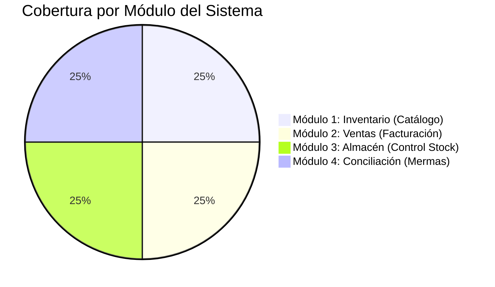
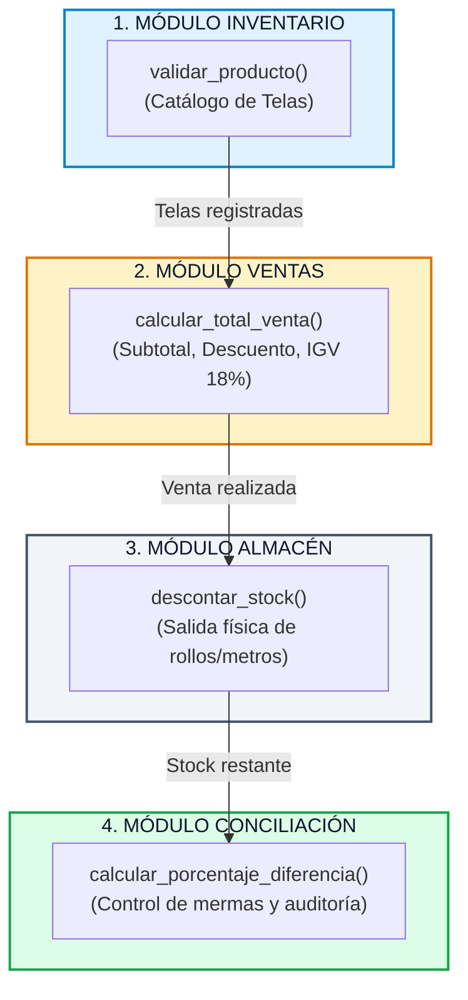
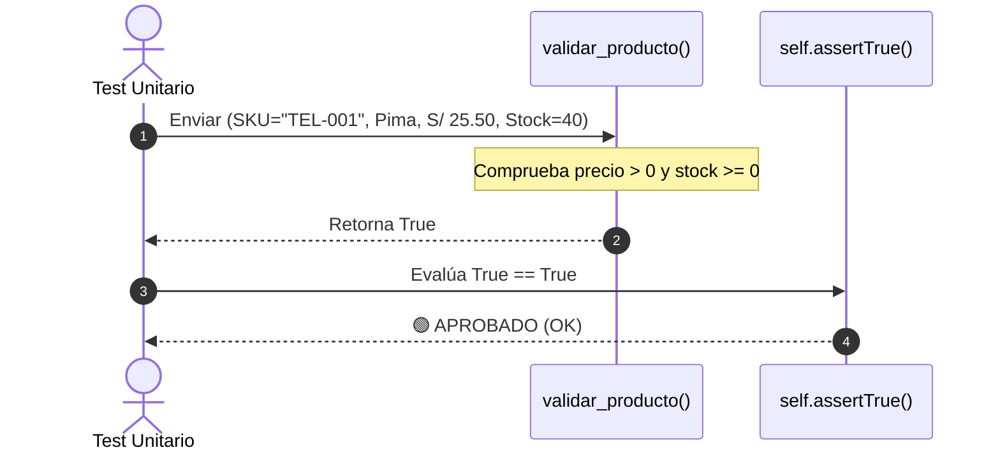
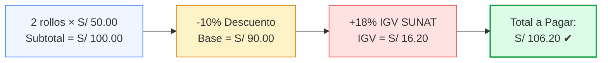
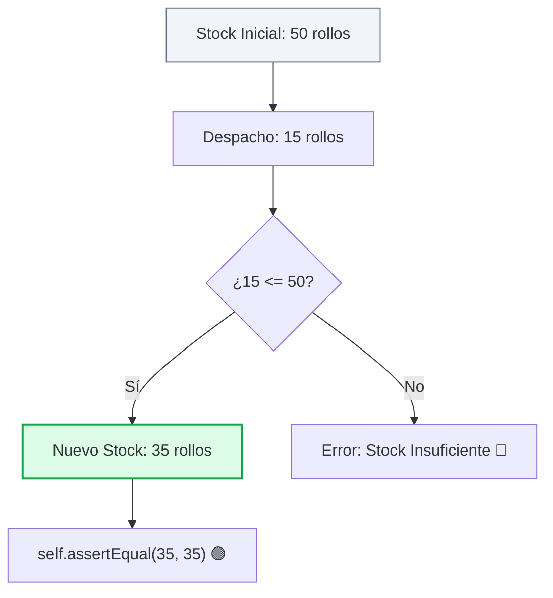
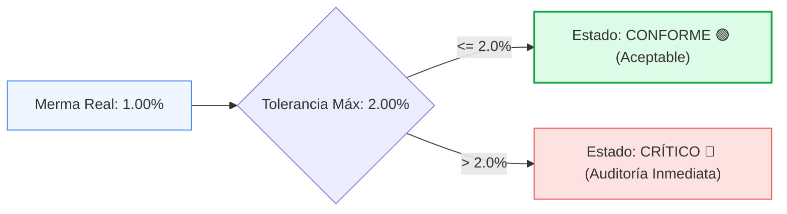

# 🧵 INFORME Y GUÍA VISUAL: 4 PRUEBAS UNITARIAS MULTI-MÓDULO
## Sistema de Ventas e Inventario · Textilería (Lima - Perú)
**Curso:** Calidad de Software · UCV 2026  
**Estándar de Calidad:** ISO/IEC 25010 (Adecuación Funcional, Exactitud de Cálculo y Tolerancia a Fallos)  
**Script Ejecutable:** [`ejemplo_pruebas_unitarias.py`](file:///c:/Users/AlvaroJ/Documents/Antigravity%20Projects/sistema-textileria/ejemplo_pruebas_unitarias.py)

---

## 📊 Panel General de Resultados (Dashboard de Calidad)

| Métrica | Valor Obtenido | Estado | Observación |
| :--- | :---: | :---: | :--- |
| **Módulos Evaluados** | `4` | 🟢 Multidisciplinario | Inventario, Ventas, Almacén y Conciliación |
| **Pruebas Diseñadas** | `4` | 🟢 Listo | 1 función crítica por cada área clave |
| **Pruebas Ejecutadas** | `4 / 4` | 🟢 100% | Ejecución limpia y aislada |
| **Pruebas Aprobadas (`PASSED`)** | `4 / 4` | 🟢 100% | Todas las aserciones fueron exitosas |
| **Pruebas Fallidas (`FAILED`)** | `0` | 🟢 Cero errores | Precisión matemática exacta |
| **Tiempo de Ejecución** | `0.000s` | ⚡ Instantáneo | Pruebas unitarias sin dependencias externas |
| **Framework Utilizado** | `unittest` | 🐍 Estándar Python | Nativo, sin necesidad de librerías extras |



---

## 🗺️ Mapa de los 4 Módulos y sus Funciones Críticas

En un sistema textil integral, cada módulo cumple un rol indispensable en la cadena de valor:



---

## 🔬 Detalle de las 4 Pruebas Unitarias

---

### 1️⃣ Módulo Inventario: `validar_producto`

#### 📌 ¿Qué hace y por qué se prueba?
Valida que un nuevo rollo o tela cumpla con los datos mínimos para ingresar al catálogo: SKU obligatorio, nombre, precio mayor a 0 y stock no negativo. Evita registros corruptos en el catálogo textil.

#### 💻 Código Corto
```python
# Función
def validar_producto(sku: str, nombre: str, precio: float, stock: int) -> bool:
    if not sku.strip() or not nombre.strip():
        return False
    if precio <= 0 or stock < 0:
        return False
    return True

# Prueba Unitaria
def test_01_validar_producto_inventario(self):
    es_valido = validar_producto(sku="TEL-001", nombre="Tela Algodon Pima", precio=25.50, stock=40)
    self.assertTrue(es_valido)
```

#### 📊 Diagrama de Secuencia


#### 🖥️ Resultado en Terminal
```text
Modulo     : 1. Inventario (Catalogo de Telas)
Entrada    : SKU: 'TEL-001' | Pima | S/ 25.50 | Stock: 40
Esperado   : True (Valido)
Obtenido   : True (Valido)
Resultado  : [APROBADO]
```

---

### 2️⃣ Módulo Ventas: `calcular_total_venta`

#### 📌 ¿Qué hace y por qué se prueba?
Orquesta el cálculo comercial completo: multiplica metraje por precio, aplica el porcentaje de descuento y suma el **18% de IGV (normativa SUNAT)**. Evita pérdidas económicas y descuadres tributarios.

#### 💻 Código Corto
```python
# Función
def calcular_total_venta(cantidad: int, precio_unitario: float, descuento_pct: float = 0.0) -> float:
    subtotal = cantidad * precio_unitario
    monto_descuento = subtotal * (descuento_pct / 100)
    base_imponible = subtotal - monto_descuento
    igv = base_imponible * 0.18
    return round(base_imponible + igv, 2)

# Prueba Unitaria
def test_02_calcular_total_ventas(self):
    # 2 rollos * S/ 50 = S/ 100 subtotal - 10% desc = S/ 90 base + 18% IGV (16.20) = 106.20
    total = calcular_total_venta(cantidad=2, precio_unitario=50.00, descuento_pct=10.0)
    self.assertEqual(total, 106.20)
```

#### 📊 Desglose de Cálculo


#### 🖥️ Resultado en Terminal
```text
Modulo     : 2. Ventas (Caja y Facturacion)
Entrada    : Cant: 2 rollos | Precio: S/ 50.00 | Desc: 10% | IGV: 18%
Esperado   : S/ 106.20
Obtenido   : S/ 106.20
Resultado  : [APROBADO]
```

---

### 3️⃣ Módulo Almacén: `descontar_stock`

#### 📌 ¿Qué hace y por qué se prueba?
Controla la salida física de rollos o metros del almacén tras un despacho. Garantiza que el inventario se actualice en tiempo real y rechaza salidas que dejen el stock en negativo.

#### 💻 Código Corto
```python
# Función
def descontar_stock(stock_actual: int, cantidad_a_descontar: int) -> int:
    if cantidad_a_descontar <= 0:
        raise ValueError("La cantidad a descontar debe ser mayor a 0.")
    if cantidad_a_descontar > stock_actual:
        raise ValueError("Stock insuficiente para despachar.")
    return stock_actual - cantidad_a_descontar

# Prueba Unitaria
def test_03_descontar_stock_almacen(self):
    # Stock inicial 50 m, se despachan 15 m -> deben quedar 35 m
    nuevo_stock = descontar_stock(stock_actual=50, cantidad_a_descontar=15)
    self.assertEqual(nuevo_stock, 35)
```

#### 📊 Diagrama de Flujo


#### 🖥️ Resultado en Terminal
```text
Modulo     : 3. Almacen (Control de Stock)
Entrada    : Stock inicial: 50 m | Salida despachada: 15 m
Esperado   : 35 metros
Obtenido   : 35 metros
Resultado  : [APROBADO]
```

---

### 4️⃣ Módulo Conciliación: `calcular_porcentaje_diferencia`

#### 📌 ¿Qué hace y por qué se prueba?
Compara el stock registrado en el sistema contra el conteo físico en estantería para controlar **mermas textiles** por cortes o retazos. Si la diferencia es menor o igual al umbral del negocio (**2%**), se declara `CONFORME`.

#### 💻 Código Corto
```python
# Función
def calcular_porcentaje_diferencia(stock_sistema: int, conteo_fisico: int) -> dict:
    diferencia = conteo_fisico - stock_sistema
    porcentaje = round(abs(diferencia) / stock_sistema * 100, 2)
    conforme = porcentaje <= 2.0  # Umbral de tolerancia textil: 2%
    return {"diferencia": diferencia, "porcentaje": porcentaje, "conforme": conforme}

# Prueba Unitaria
def test_04_conciliacion_auditoria(self):
    # 100 m en sistema vs 99 m físico = 1% de merma (dentro del límite del 2%)
    resultado = calcular_porcentaje_diferencia(stock_sistema=100, conteo_fisico=99)
    self.assertEqual(resultado["porcentaje"], 1.0)
    self.assertTrue(resultado["conforme"])
```

#### 📊 Semáforo de Tolerancia de Mermas


#### 🖥️ Resultado en Terminal
```text
Modulo     : 4. Conciliacion (Mermas y Auditoria)
Entrada    : Sistema: 100 m | Conteo Fisico: 99 m (Tolerancia: <= 2%)
Esperado   : Conforme (Merma: 1.00%)
Obtenido   : Conforme (Merma: 1.00%)
Resultado  : [APROBADO]
```

---

## 📋 Cuadro Comparativo Resumen para Sustentación

Copia y pega este cuadro directamente en tu informe, diapositiva o documento:

| N° | Módulo del Sistema | Función Evaluada | Datos de Entrada | Resultado Esperado | Resultado Obtenido | Estado | Justificación de Negocio |
| :---: | :--- | :--- | :--- | :---: | :---: | :---: | :--- |
| **01** | **Inventario** | `validar_producto` | SKU: `'TEL-001'`, Pima, Precio: S/ 25.50, Stock: 40 | `True` *(Válido)* | `True` *(Válido)* | 🟢 **APROBADO** | Valida atributos obligatorios antes del guardado en catálogo. |
| **02** | **Ventas** | `calcular_total_venta` | 2 rollos a S/ 50.00, Descuento: 10%, IGV: 18% | `S/ 106.20` | `S/ 106.20` | 🟢 **APROBADO** | Liquida el comprobante aplicando descuento e IGV SUNAT. |
| **03** | **Almacén** | `descontar_stock` | Stock actual: 50 m, Cantidad venta: 15 m | `35 metros` | `35 metros` | 🟢 **APROBADO** | Rebaja inventario físico y previene stock negativo. |
| **04** | **Conciliación** | `calcular_porcentaje_diferencia` | Sistema: 100 m, Conteo físico: 99 m | `Conforme (1.00%)` | `Conforme (1.00%)` | 🟢 **APROBADO** | Control de mermas bajo el umbral de tolerancia del 2.0%. |

---

## 🚀 Cómo Ejecutar la Demostración en Vivo

En cualquier terminal dentro del proyecto:

```bash
python ejemplo_pruebas_unitarias.py
```

### Salida Completa Obtenida:
```text
================================================================================
 ACTIVIDAD: 4 PRUEBAS UNITARIAS MULTI-MODULO - SISTEMA TEXTILERIA
================================================================================
Modulo     : 1. Inventario (Catalogo de Telas)
Entrada    : SKU: 'TEL-001' | Pima | S/ 25.50 | Stock: 40
Esperado   : True (Valido)
Obtenido   : True (Valido)
Resultado  : [APROBADO]
--------------------------------------------------------------------------------
Modulo     : 2. Ventas (Caja y Facturacion)
Entrada    : Cant: 2 rollos | Precio: S/ 50.00 | Desc: 10% | IGV: 18%
Esperado   : S/ 106.20
Obtenido   : S/ 106.20
Resultado  : [APROBADO]
--------------------------------------------------------------------------------
Modulo     : 3. Almacen (Control de Stock)
Entrada    : Stock inicial: 50 m | Salida despachada: 15 m
Esperado   : 35 metros
Obtenido   : 35 metros
Resultado  : [APROBADO]
--------------------------------------------------------------------------------
Modulo     : 4. Conciliacion (Mermas y Auditoria)
Entrada    : Sistema: 100 m | Conteo Fisico: 99 m (Tolerancia: <= 2%)
Esperado   : Conforme (Merma: 1.00%)
Obtenido   : Conforme (Merma: 1.00%)
Resultado  : [APROBADO]
--------------------------------------------------------------------------------

Ejecutando verificacion formal con unittest:
test_01_validar_producto_inventario (__main__.TestSistemaTextil.test_01_validar_producto_inventario) ... ok
test_02_calcular_total_ventas (__main__.TestSistemaTextil.test_02_calcular_total_ventas) ... ok
test_03_descontar_stock_almacen (__main__.TestSistemaTextil.test_03_descontar_stock_almacen) ... ok
test_04_conciliacion_auditoria (__main__.TestSistemaTextil.test_04_conciliacion_auditoria) ... ok

----------------------------------------------------------------------
Ran 4 tests in 0.000s

OK
```

---

## 🎯 Sustentación bajo Norma ISO/IEC 25010

1. **Adecuación Funcional:** Se valida la completitud y exactitud de las 4 operaciones más sensibles del negocio textil (catálogo, liquidación de venta, movimiento de almacén y merma).
2. **Confiabilidad:** Las funciones puras son deterministas: ante las mismas entradas siempre devuelven idénticos resultados esperados.
3. **Mantenibilidad:** El código es modular, corto y desacoplado, lo que permite modificar reglas de negocio futuras (ej. cambio de tasa del IGV o tolerancia de merma) sin romper el resto del sistema.
