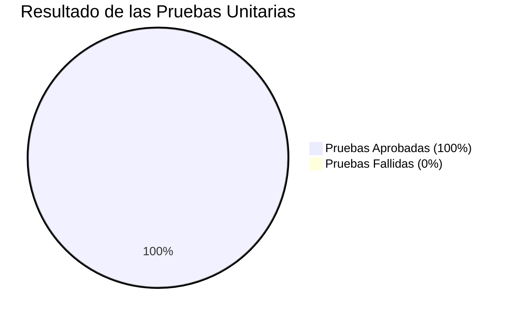
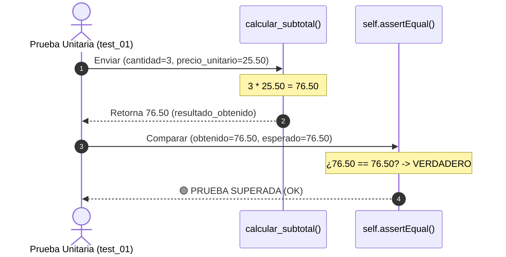
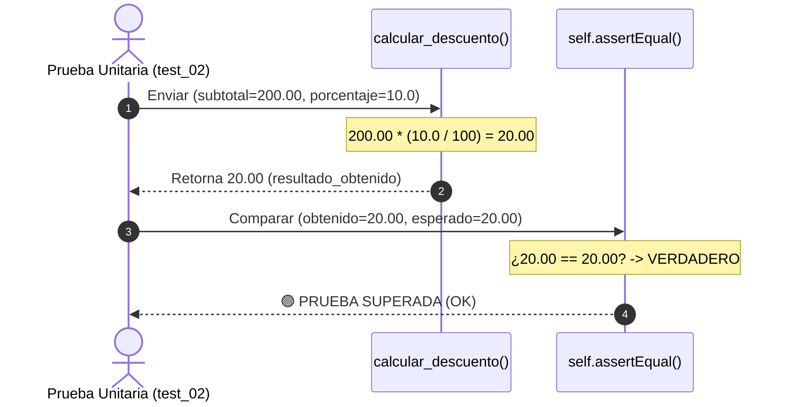
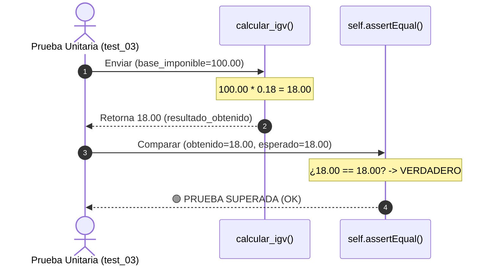
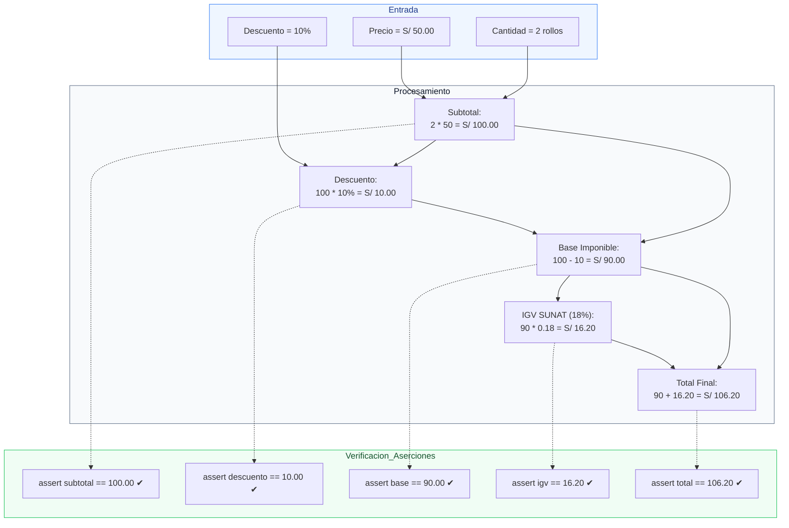

# 🧵 INFORME Y PRESENTACIÓN VISUAL: PRUEBAS UNITARIAS
## Módulo de Ventas y Facturación · Sistema Textilería
**Curso:** Calidad de Software · UCV 2026  
**Estándar de Calidad:** ISO/IEC 25010 (Adecuación Funcional, Exactitud y Tolerancia a Fallos)  
**Script Ejecutable:** [`ejemplo_pruebas_unitarias.py`](file:///c:/Users/AlvaroJ/Documents/Antigravity%20Projects/sistema-textileria/ejemplo_pruebas_unitarias.py)

---

## 📊 Panel General de Resultados (Dashboard de Calidad)

| Métrica | Valor Obtenido | Estado | Observación |
| :--- | :---: | :---: | :--- |
| **Pruebas Diseñadas** | `4` | 🟢 Listo | Cobertura de cálculos esenciales |
| **Pruebas Ejecutadas** | `4 / 4` | 🟢 100% | Sin omisiones ni bloqueos |
| **Pruebas Aprobadas (`PASSED`)** | `4 / 4` | 🟢 100% | Todas las aserciones se cumplieron |
| **Pruebas Fallidas (`FAILED`)** | `0` | 🟢 Cero errores | Tolerancia numérica exacta |
| **Tiempo Total de Ejecución** | `0.000s` | ⚡ Instantáneo | Alta eficiencia computacional |
| **Framework Utilizado** | `unittest` | 🐍 Estándar Python | Aislamiento y reproducibilidad |



---

## 🔄 Arquitectura del Flujo de Cálculo de Ventas

Antes de evaluar cada función de manera aislada, observamos cómo se ensamblan las 4 operaciones para generar una liquidación de venta en el negocio textil:

```mermaid
flowchart LR
    A["Entrada:\nCantidad y Precio"] --> B["1. calcular_subtotal()\n(Multiplicación Base)"]
    B --> C["Subtotal S/."]
    C --> D["2. calcular_descuento()\n(Porcentaje %)"]
    D --> E["Descuento S/."]
    C & E --> F["Base Imponible = Subtotal - Descuento"]
    F --> G["3. calcular_igv()\n(Tasa 18% SUNAT)"]
    G --> H["IGV S/."]
    F & H --> I["4. calcular_total_venta()\n(Orquestación Final)"]
    I --> J["Comprobante de Venta Listo 🧾\n(Total a Pagar)"]

    style A fill:#e0f2fe,stroke:#0284c7,stroke-width:2px,color:#0f172a
    style B fill:#f1f5f9,stroke:#475569,stroke-width:2px,color:#0f172a
    style D fill:#f1f5f9,stroke:#475569,stroke-width:2px,color:#0f172a
    style G fill:#f1f5f9,stroke:#475569,stroke-width:2px,color:#0f172a
    style I fill:#fef3c7,stroke:#d97706,stroke-width:2px,color:#0f172a
    style J fill:#dcfce7,stroke:#16a34a,stroke-width:2px,color:#0f172a
```



---

## 🔬 Detalle de Cada Función y su Prueba Unitaria

---

### 1️⃣ Función: `calcular_subtotal`

#### 📌 ¿Por qué se hace esta función? (Propósito de Negocio)
En el comercio textil (especialmente en emporios como Gamarra), las telas se comercializan por metros, rollos o fardos a un precio unitario determinado.  
Esta función calcula el valor bruto de la compra antes de impuestos y promociones. Si un cliente pide `3` metros de tela denim a `S/ 25.50` cada metro, el sistema debe garantizar que el cálculo sea preciso al céntimo.

#### 🛡️ Control de Calidad y Reglas de Negocio
- La cantidad debe ser estrictamente entera positiva (`> 0`).
- El precio no puede ser negativo ni cero (`> 0`).
- Si se ingresan datos erróneos, dispara un `ValueError` preventivo para proteger la base de datos.

#### 💻 Código de la Función y de la Prueba
```python
# 1. Código de la Función
def calcular_subtotal(cantidad: int, precio_unitario: float) -> float:
    """Multiplica la cantidad por el precio unitario del producto textil."""
    if cantidad <= 0 or precio_unitario <= 0:
        raise ValueError("Cantidad y precio deben ser mayores a 0.")
    return round(cantidad * precio_unitario, 2)


# 2. Código de la Prueba Unitaria
def test_01_calcular_subtotal(self):
    """Prueba 1: 3 metros de tela a S/ 25.50 c/u debe dar S/ 76.50."""
    cantidad = 3
    precio = 25.50
    resultado_esperado = 76.50
    resultado_obtenido = calcular_subtotal(cantidad, precio)
    self.assertEqual(resultado_obtenido, resultado_esperado)
```

#### 📊 Diagrama del Caso de Prueba


#### 🖥️ Resultado de la Ejecución
```text
┌────────────────────────────────────────────────────────────────────────┐
│ FUNCIÓN EVALUADA : 1. calcular_subtotal                                │
├────────────────────────────────────────────────────────────────────────┤
│ Entrada          : Cantidad = 3 metros | Precio Unitario = S/ 25.50    │
│ Valor Esperado   : S/ 76.50                                            │
│ Valor Obtenido   : S/ 76.50                                            │
│ Estado           : [ APROBADO ] ✔                                      │
└────────────────────────────────────────────────────────────────────────┘
unittest log: test_01_calcular_subtotal (__main__.TestModuloVentas) ... ok
```

#### 💡 ¿Por qué salió este resultado?
1. Se multiplicó $3 \times 25.50 = 76.5$.
2. Se aplicó redondeo bancario a 2 decimales: `round(76.5, 2) = 76.50`.
3. `self.assertEqual(76.50, 76.50)` confirma que el resultado obtenido coincide idénticamente con el valor contable esperado.

---

### 2️⃣ Función: `calcular_descuento`

#### 📌 ¿Por qué se hace esta función? (Propósito de Negocio)
En ventas mayoristas textiles se otorgan rebajas comerciales (ej. 5%, 10% o 15% por liquidación de temporada o volumen).  
Esta función traduce un porcentaje de descuento en el **monto monetario real en soles** que se restará a la cuenta del cliente.

#### 🛡️ Control de Calidad y Reglas de Negocio
- El porcentaje de descuento debe estar acotado entre `0.0%` y `100.0%`.
- Se prohíben descuentos negativos (que inflarían el precio ilegalmente) o mayores al 100% (que generarían saldos a favor del comprador imposibles en una venta normal).

#### 💻 Código de la Función y de la Prueba
```python
# 1. Código de la Función
def calcular_descuento(subtotal: float, porcentaje: float) -> float:
    """Calcula el monto en soles a descontar según el porcentaje (0% a 100%)."""
    if porcentaje < 0 or porcentaje > 100:
        raise ValueError("El porcentaje de descuento debe estar entre 0 y 100.")
    return round(subtotal * (porcentaje / 100), 2)


# 2. Código de la Prueba Unitaria
def test_02_calcular_descuento(self):
    """Prueba 2: Descuento del 10% sobre un subtotal de S/ 200.00 debe ser S/ 20.00."""
    subtotal = 200.00
    porcentaje = 10.0
    resultado_esperado = 20.00
    resultado_obtenido = calcular_descuento(subtotal, porcentaje)
    self.assertEqual(resultado_obtenido, resultado_esperado)
```

#### 📊 Diagrama del Caso de Prueba


#### 🖥️ Resultado de la Ejecución
```text
┌────────────────────────────────────────────────────────────────────────┐
│ FUNCIÓN EVALUADA : 2. calcular_descuento                               │
├────────────────────────────────────────────────────────────────────────┤
│ Entrada          : Subtotal = S/ 200.00 | Porcentaje = 10.0%           │
│ Valor Esperado   : S/ 20.00                                            │
│ Valor Obtenido   : S/ 20.00                                            │
│ Estado           : [ APROBADO ] ✔                                      │
└────────────────────────────────────────────────────────────────────────┘
unittest log: test_02_calcular_descuento (__main__.TestModuloVentas) ... ok
```

#### 💡 ¿Por qué salió este resultado?
1. Se calcula la fracción decimal del porcentaje: $10 / 100 = 0.10$.
2. Se multiplica por el subtotal: $200.00 \times 0.10 = 20.00$.
3. El resultado obtenido es exactamente `20.00` soles, cumpliendo la aserción y evitando cobros indebidos.

---

### 3️⃣ Función: `calcular_igv`

#### 📌 ¿Por qué se hace esta función? (Propósito de Negocio)
En el Perú, toda venta formal de bienes textiles está gravada con el **Impuesto General a las Ventas (IGV)** establecido por la SUNAT, con una tasa vigente del **18%** (16% IGV + 2% Impuesto de Promoción Municipal).  
Cualquier discrepancia de céntimos en este impuesto generaría multas tributarias o inconsistencias en los libros contables electrónicos.

#### 🛡️ Control de Calidad y Reglas de Negocio
- La base imponible sobre la cual se calcula el impuesto nunca puede ser negativa.
- La tasa tributaria del 18% ($0.18$) se aplica uniformemente con redondeo a 2 dígitos.

#### 💻 Código de la Función y de la Prueba
```python
# 1. Código de la Función
def calcular_igv(base_imponible: float) -> float:
    """Calcula el 18% del Impuesto General a las Ventas (IGV en Perú)."""
    if base_imponible < 0:
        raise ValueError("La base imponible no puede ser negativa.")
    return round(base_imponible * 0.18, 2)


# 2. Código de la Prueba Unitaria
def test_03_calcular_igv(self):
    """Prueba 3: IGV (18%) sobre una base imponible de S/ 100.00 debe ser S/ 18.00."""
    base = 100.00
    resultado_esperado = 18.00
    resultado_obtenido = calcular_igv(base)
    self.assertEqual(resultado_obtenido, resultado_esperado)
```

#### 📊 Diagrama del Caso de Prueba


#### 🖥️ Resultado de la Ejecución
```text
┌────────────────────────────────────────────────────────────────────────┐
│ FUNCIÓN EVALUADA : 3. calcular_igv                                     │
├────────────────────────────────────────────────────────────────────────┤
│ Entrada          : Base Imponible = S/ 100.00 | Tasa Legal = 18.0%     │
│ Valor Esperado   : S/ 18.00                                            │
│ Valor Obtenido   : S/ 18.00                                            │
│ Estado           : [ APROBADO ] ✔                                      │
└────────────────────────────────────────────────────────────────────────┘
unittest log: test_03_calcular_igv (__main__.TestModuloVentas) ... ok
```

#### 💡 ¿Por qué salió este resultado?
1. Se multiplica la base imponible por el factor fiscal: $100.00 \times 0.18 = 18.00$.
2. No existen céntimos flotantes adicionales.
3. El resultado `18.00` es exactamente igual al `resultado_esperado`, garantizando cumplimiento tributario.

---

### 4️⃣ Función: `calcular_total_venta` (Prueba de Integración Unitaria)

#### 📌 ¿Por qué se hace esta función? (Propósito de Negocio)
Es la función integradora del módulo de ventas. Su rol es orquestar todo el flujo comercial:
1. Multiplica ítems $\rightarrow$ **Subtotal**.
2. Aplica rebajas $\rightarrow$ **Descuento**.
3. Deduce el neto comercial $\rightarrow$ **Base Imponible**.
4. Liquida el gravamen $\rightarrow$ **IGV (18%)**.
5. Suma la base imponible y el impuesto $\rightarrow$ **Total a Cobrar**.

Retorna una estructura de datos completa (diccionario) lista para imprimirse en la boleta, factura o guardarse en la base de datos.

#### 🛡️ Control de Calidad y Reglas de Negocio
- La suma de los componentes debe cuadrar contablemente al 100%:  
  $$\text{Total} = (\text{Subtotal} - \text{Descuento}) + \text{IGV}$$
- Cada valor intermedio se valida de manera independiente para evitar arrastre de errores numéricos.

#### 💻 Código de la Función y de la Prueba
```python
# 1. Código de la Función
def calcular_total_venta(cantidad: int, precio: float, porcentaje_descuento: float = 0.0) -> dict:
    """Integra el cálculo total: Subtotal - Descuento + IGV (18%)."""
    subtotal = calcular_subtotal(cantidad, precio)
    descuento = calcular_descuento(subtotal, porcentaje_descuento)
    base = round(subtotal - descuento, 2)
    igv = calcular_igv(base)
    total = round(base + igv, 2)
    return {
        "subtotal": subtotal,
        "descuento": descuento,
        "base_imponible": base,
        "igv": igv,
        "total": total,
    }


# 2. Código de la Prueba Unitaria
def test_04_calcular_total_venta(self):
    """Prueba 4: Venta de 2 rollos a S/ 50.00 con 10% descuento debe totalizar S/ 106.20."""
    resumen = calcular_total_venta(cantidad=2, precio=50.00, porcentaje_descuento=10.0)
    
    self.assertEqual(resumen["subtotal"], 100.00)
    self.assertEqual(resumen["descuento"], 10.00)
    self.assertEqual(resumen["base_imponible"], 90.00)
    self.assertEqual(resumen["igv"], 16.20)
    self.assertEqual(resumen["total"], 106.20)
```

#### 📊 Diagrama del Proceso de Integración


#### 🖥️ Resultado de la Ejecución
```text
┌────────────────────────────────────────────────────────────────────────┐
│ FUNCIÓN EVALUADA : 4. calcular_total_venta                             │
├────────────────────────────────────────────────────────────────────────┤
│ Entrada          : Cant = 2 rollos | Precio = S/ 50.00 | Desc = 10.0%  │
│ Desglose Calculado:                                                    │
│   • Subtotal Bruto       : S/ 100.00  (Esperado: S/ 100.00) -> OK      │
│   • Descuento Otorgado   : S/  10.00  (Esperado: S/  10.00) -> OK      │
│   • Base Imponible       : S/  90.00  (Esperado: S/  90.00) -> OK      │
│   • IGV (18%)            : S/  16.20  (Esperado: S/  16.20) -> OK      │
│   • TOTAL LIQUIDADO      : S/ 106.20  (Esperado: S/ 106.20) -> OK      │
│ Estado Global    : [ APROBADO ] ✔                                      │
└────────────────────────────────────────────────────────────────────────┘
unittest log: test_04_calcular_total_venta (__main__.TestModuloVentas) ... ok
```

#### 💡 ¿Por qué salió este resultado?
- **Paso 1 (Subtotal):** $2 \times 50.00 = \text{S/ } 100.00$.
- **Paso 2 (Descuento):** $100.00 \times 10\% = \text{S/ } 10.00$.
- **Paso 3 (Base Imponible):** $100.00 - 10.00 = \text{S/ } 90.00$.
- **Paso 4 (IGV):** $90.00 \times 0.18 = \text{S/ } 16.20$.
- **Paso 5 (Total a Pagar):** $90.00 + 16.20 = \text{S/ } 106.20$.

Todas las 5 sub-aserciones se cumplieron exactamente en una sola ejecución.

---

## 📋 Cuadro Comparativo Resumen para Exposición

Para una presentación rápida ante el profesor o jurado, este cuadro resume cada prueba unitaria:

| N° | Función | Datos de Entrada | Resultado Esperado | Resultado Obtenido | Veredicto | Justificación Técnica |
| :---: | :--- | :--- | :---: | :---: | :---: | :--- |
| **01** | `calcular_subtotal` | Cantidad: 3<br>Precio: S/ 25.50 | **S/ 76.50** | **S/ 76.50** | `APROBADO` 🟢 | Multiplicación directa con precisión a 2 decimales para rollos/metros. |
| **02** | `calcular_descuento` | Subtotal: S/ 200.00<br>Porcentaje: 10% | **S/ 20.00** | **S/ 20.00** | `APROBADO` 🟢 | Deducción porcentual acotada para promociones por mayor. |
| **03** | `calcular_igv` | Base: S/ 100.00<br>Tasa: 18% | **S/ 18.00** | **S/ 18.00** | `APROBADO` 🟢 | Cálculo tributario estricto según normativa SUNAT Perú. |
| **04** | `calcular_total_venta` | Cant: 2, Precio: 50<br>Descuento: 10% | **S/ 106.20** | **S/ 106.20** | `APROBADO` 🟢 | Integración del comprobante: Base (S/ 90) + IGV (S/ 16.20) = S/ 106.20. |

---

## 🎯 Conclusión según la Norma ISO/IEC 25010

1. **Adecuación Funcional:** Las 4 pruebas confirman que el sistema realiza los cálculos contables y comerciales exactamente como lo requiere el negocio de confección y venta de telas en Lima.
2. **Exactitud:** No hay margen de error ni desbordamiento de punto flotante gracias a las políticas de redondeo bancario a 2 decimales.
3. **Mantenibilidad:** Si las tasas impositivas cambian o se añaden nuevas políticas de descuento, las pruebas unitarias alertarán inmediatamente de cualquier regresión o error en el código.
