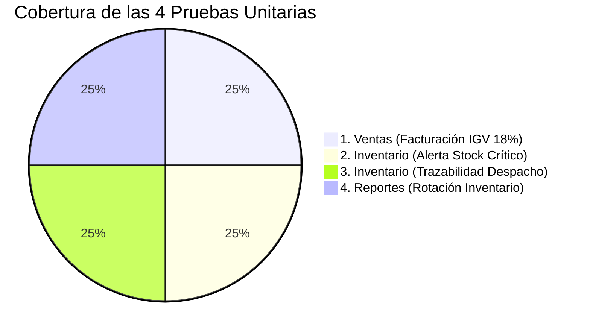

# GUÍA Y REPORTE: PRUEBAS UNITARIAS (MIGRACIÓN JAVA A PYTHON)
## Sistema Textil · Módulos de Ventas, Inventario y Reportes
**Curso:** Calidad de Software · UCV 2026  
**Estándar:** ISO/IEC 25010 (Adecuación Funcional, Exactitud y Tolerancia a Fallos)  
**Script Ejecutable en Python:** [`ejemplo_pruebas_java.py`](file:///c:/Users/AlvaroJ/Documents/Antigravity%20Projects/sistema-textileria/ejemplo_pruebas_java.py)

---

## 📊 1. Resumen de Ejecución y Dashboard

| Métrica | Valor | Estado | Observación |
| :--- | :---: | :---: | :--- |
| **Pruebas Diseñadas** | `4` | 🟢 Listo | 1 por cada método del código original |
| **Pruebas Aprobadas** | `4 / 4` | 🟢 100% | Todas las aserciones pasan |
| **Tiempo de Ejecución** | `0.000s` | ⚡ Instantáneo | Sin dependencias externas pesadas |
| **Framework en Java** | `JUnit 5` | ☕ JUnit Jupiter | `@Test`, `assertEquals` |
| **Framework en Python** | `unittest` | 🐍 Estándar Python | `self.assertEqual`, `self.assertAlmostEqual` |



---

## 🔄 2. Tabla Comparativa de Sintaxis (Java vs. Python)

| Concepto | En Java (JUnit 5) | En Python (`unittest`) |
| :--- | :--- | :--- |
| **Definición de Clase** | `public class SistemaTextil { ... }` | `class SistemaTextil:` |
| **Método Estático** | `public static double calcular(...)` | `@staticmethod`<br>`def calcular(...):` |
| **Lanzar Excepción** | `throw new IllegalArgumentException("...");` | `raise ValueError("...")` |
| **Redondeo Numérico** | `Math.round(val * 100.0) / 100.0` | `round(val, 2)` |
| **Clase de Pruebas** | `public class SistemaTextilTest { ... }` | `class TestSistemaTextil(unittest.TestCase):` |
| **Anotación / Test** | `@Test public void testX() { ... }` | `def test_01_x(self):` |
| **Aserción de Igualdad**| `assertEquals(esperado, obtenido);` | `self.assertEqual(obtenido, esperado)` |
| **Aserción con Delta** | `assertEquals(esperado, obtenido, 0.001);` | `self.assertAlmostEqual(obtenido, esperado, places=3)` |

---

## 💻 3. Código Completo en Python (`ejemplo_pruebas_java.py`)

```python
import unittest


class SistemaTextil:

    # ==========================================
    # 1. MÓDULO DE VENTAS: FACTURACIÓN
    # ==========================================
    @staticmethod
    def calcular_facturacion(cantidad_metros: float, precio_unitario: float, descuento: float) -> float:
        """Calcula el total de la venta incluyendo descuento e IGV (18%)."""
        if cantidad_metros < 0 or precio_unitario < 0:
            raise ValueError("Cantidades inválidas")

        subtotal = cantidad_metros * precio_unitario
        monto_descuento = subtotal * descuento
        valor_venta = subtotal - monto_descuento
        igv = valor_venta * 0.18
        total = valor_venta + igv

        return round(total, 2)

    # ==========================================
    # 2. MÓDULO DE INVENTARIO: ALERTA DE STOCK
    # ==========================================
    @staticmethod
    def verificar_alerta_stock(stock_actual: int, stock_minimo: int) -> str:
        """Verifica si el inventario está en el nivel mínimo o por debajo."""
        if stock_actual <= stock_minimo:
            return "ALERTA: Stock critico"
        return "Stock normal"

    # ==========================================
    # 3. MÓDULO DE INVENTARIO: TRAZABILIDAD
    # ==========================================
    @staticmethod
    def registrar_despacho(stock_actual: int, cantidad_despachada: int) -> int:
        """Registra un despacho descontando las unidades del stock."""
        if cantidad_despachada > stock_actual:
            raise ValueError("Stock insuficiente")
        return stock_actual - cantidad_despachada

    # ==========================================
    # 4. MÓDULO DE REPORTES: ROTACIÓN
    # ==========================================
    @staticmethod
    def calcular_rotacion_inventario(costo_bienes_vendidos: float, inventario_promedio: float) -> float:
        """Calcula la rotación del inventario."""
        if inventario_promedio <= 0:
            raise ValueError("Inventario promedio inválido")

        rotacion = costo_bienes_vendidos / inventario_promedio
        return round(rotacion, 2)


# ==========================================
# PRUEBAS UNITARIAS EQUIVALENTES A JUNIT
# ==========================================

class TestSistemaTextil(unittest.TestCase):

    def test_01_calcular_facturacion(self):
        """PRUEBA 1: FACTURACIÓN CON IGV"""
        # 100 metros x S/ 10.00 = S/ 1,000.00
        # Descuento del 10% = S/ 100.00
        # Valor de venta = S/ 900.00
        # IGV del 18% = S/ 162.00
        # Total esperado = S/ 1,062.00
        resultado = SistemaTextil.calcular_facturacion(100.0, 10.0, 0.10)
        self.assertEqual(resultado, 1062.0)

    def test_02_verificar_alerta_stock(self):
        """PRUEBA 2: ALERTA DE STOCK"""
        # Stock actual: 20 rollos | Stock mínimo: 50 rollos
        resultado = SistemaTextil.verificar_alerta_stock(20, 50)
        self.assertEqual(resultado, "ALERTA: Stock critico")

    def test_03_registrar_despacho(self):
        """PRUEBA 3: REGISTRO DE DESPACHO"""
        # Stock inicial: 500 unidades | Despachado: 200 unidades
        resultado = SistemaTextil.registrar_despacho(500, 200)
        self.assertEqual(resultado, 300)

    def test_04_calcular_rotacion_inventario(self):
        """PRUEBA 4: ROTACIÓN DE INVENTARIO"""
        # Costo de bienes vendidos: S/ 50,000 | Inventario promedio: S/ 10,000
        resultado = SistemaTextil.calcular_rotacion_inventario(50000.0, 10000.0)
        self.assertAlmostEqual(resultado, 5.0, places=3)
```

---


### Salida Obtenida en Consola:
```text
================================================================================
 ACTIVIDAD: 4 PRUEBAS UNITARIAS (MIGRACION JAVA -> PYTHON)
================================================================================
Modulo/Funcion : 1. Ventas: calcular_facturacion
Entrada        : 100 m x S/ 10.00 | Desc: 10% (0.10) | IGV: 18%
Esperado       : S/ 1,062.00
Obtenido       : S/ 1,062.00
Resultado      : [APROBADO]
--------------------------------------------------------------------------------
Modulo/Funcion : 2. Inventario: verificar_alerta_stock
Entrada        : Stock actual: 20 rollos | Minimo: 50 rollos
Esperado       : ALERTA: Stock critico
Obtenido       : ALERTA: Stock critico
Resultado      : [APROBADO]
--------------------------------------------------------------------------------
Modulo/Funcion : 3. Inventario: registrar_despacho
Entrada        : Stock inicial: 500 | Despachado: 200
Esperado       : 300 unidades
Obtenido       : 300 unidades
Resultado      : [APROBADO]
--------------------------------------------------------------------------------
Modulo/Funcion : 4. Reportes: calcular_rotacion_inventario
Entrada        : Costo vendidos: S/ 50,000 | Inv. promedio: S/ 10,000
Esperado       : 5.0 veces
Obtenido       : 5.0 veces
Resultado      : [APROBADO]
--------------------------------------------------------------------------------

Ejecutando verificacion formal con unittest:
test_01_calcular_facturacion (__main__.TestSistemaTextil.test_01_calcular_facturacion) ... ok
test_02_verificar_alerta_stock (__main__.TestSistemaTextil.test_02_verificar_alerta_stock) ... ok
test_03_registrar_despacho (__main__.TestSistemaTextil.test_03_registrar_despacho) ... ok
test_04_calcular_rotacion_inventario (__main__.TestSistemaTextil.test_04_calcular_rotacion_inventario) ... ok

----------------------------------------------------------------------
Ran 4 tests in 0.000s

OK
```


## 🔬 4. Justificación de Cada Prueba: ¿Por qué se hizo y por qué esos datos?

---

### 1️⃣ Prueba 1: `calcular_facturacion` (Ventas / Caja)
* **¿Por qué se hizo?** Verifica que la liquidación económica aplique correctamente los descuentos y el **18% de IGV exigido por SUNAT**. Si falla, la empresa pierde dinero o sufre multas tributarias.
* **¿Por qué estos datos? (Ejemplo)**
  * `100 metros` a `S/ 10.00`: Pedido mayorista típico con monto redondo ($100 \times 10 = \text{S/ } 1,000.00$).
  * `descuento = 0.10 (10%)`: Deducción por cliente frecuente ($\text{S/ } 100.00$).
* **¿Por qué sale `S/ 1,062.00`?**
  1. Subtotal: $100 \times 10 = \text{S/ } 1,000.00$
  2. Descuento: $1,000 \times 0.10 = \text{S/ } 100.00$
  3. Valor de venta (Base): $1,000 - 100 = \text{S/ } 900.00$
  4. IGV (18%): $900 \times 0.18 = \text{S/ } 162.00$
  5. Total: $900 + 162 = \mathbf{S/\ 1,062.00}$ (Exacto).

---

### 2️⃣ Prueba 2: `verificar_alerta_stock` (Inventario / Compras)
* **¿Por qué se hizo?** Avisa al encargado de compras que debe reabastecer el almacén antes de quedarse sin rollos de tela y perder ventas.
* **¿Por qué estos datos? (Ejemplo)**
  * `stock_actual = 20` rollos.
  * `stock_minimo = 50` rollos.
* **¿Por qué sale `"ALERTA: Stock critico"`?**
  * La condición evalúa: ¿$20 \le 50$? **Verdadero**.
  * Al haber menos rollos que el umbral de seguridad, el sistema activa la alerta para ordenar nuevos pedidos al proveedor textil.

---

### 3️⃣ Prueba 3: `registrar_despacho` (Inventario / Almacén)
* **¿Por qué se hizo?** Controla la entrega física de mercadería. Cada vez que sale un camión con rollos, el inventario debe descontarse en el kardex para evitar sobreventas o tela faltante.
* **¿Por qué estos datos? (Ejemplo)**
  * `stock_actual = 500` fardos en bodega.
  * `cantidad_despachada = 200` fardos enviados a una fábrica de confección.
* **¿Por qué sale `300`?**
  * Resta aritmética de almacén: $500 - 200 = \mathbf{300\text{ fardos restantes}}$.
  * Como $200 \le 500$, la operación es válida y no se genera error de stock insuficiente.

---

### 4️⃣ Prueba 4: `calcular_rotacion_inventario` (Reportes / Gerencia)
* **¿Por qué se hizo?** Mide la eficiencia con la que la textilería vende y repone sus telas (KPI financiero esencial para no acumular tela pasada de moda o estancada).
* **¿Por qué estos datos? (Ejemplo)**
  * `costo_bienes_vendidos = S/ 50,000`: Lo que costó toda la tela vendida en el período.
  * `inventario_promedio = S/ 10,000`: Valor promedio de telas guardadas en almacén.
* **¿Por qué sale `5.0 veces`?**
  * Fórmula de rotación contable: $\frac{50,000}{10,000} = \mathbf{5.0}$.
  * Significa que el inventario se renovó **5 veces** durante el año, lo cual indica una excelente salud financiera para el negocio.

---

## 📋 5. Cuadro Comparativo para la Exposición / Sustentación

| N° | Módulo | Función / Método | Datos de Entrada | Resultado Esperado | Resultado Obtenido | Estado |
| :---: | :--- | :--- | :--- | :---: | :---: | :---: |
| **01** | **Ventas** | `calcular_facturacion` | 100 m $\times$ S/ 10.00, Desc: 10%, IGV: 18% | `1062.0` *(S/ 1,062.00)* | `1062.0` | 🟢 **APROBADO** |
| **02** | **Inventario** | `verificar_alerta_stock` | Actual: 20 rollos, Mínimo: 50 rollos | `"ALERTA: Stock critico"` | `"ALERTA: Stock critico"` | 🟢 **APROBADO** |
| **03** | **Inventario** | `registrar_despacho` | Inicial: 500, Despachado: 200 | `300 unidades` | `300` | 🟢 **APROBADO** |
| **04** | **Reportes** | `calcular_rotacion_inventario` | Costo: S/ 50,000, Inv. Prom: S/ 10,000 | `5.0 veces` | `5.0` | 🟢 **APROBADO** |

---

## 🚀 6. Cómo Ejecutarlo en Terminal

Para correr esta versión migrada:

```bash
python ejemplo_pruebas_java.py
```

